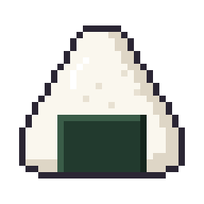

<div align="center">



# IdleManager

**Todas as suas contas de jogos de navegador numa janela só: isoladas, vigiadas e sempre de pé.**

<a href="../../releases/latest"></a>

<sub><a href="#-instalação">Como instalar</a></sub>


[](../../releases/latest)
[](#-instalação)
[](../../releases/latest)

[](https://www.electronjs.org/)
[](https://react.dev/)
[](https://www.typescriptlang.org/)
[](https://zod.dev/)
[](https://esbuild.github.io/)
[](https://vitest.dev/)
[](https://playwright.dev/)
[](#-licença)

[Instalação](#-instalação) •
[Funcionalidades](#-funcionalidades) •
[Como usar](#-como-usar) •
[Privacidade](#-privacidade-e-segurança) •
[Gere o pacote](#-gere-o-pacote-você-mesmo)

</div>

---

## 🍙 Sobre

O **IdleManager** é um app desktop para Linux que roda jogos de navegador com várias contas ao mesmo tempo, cada
uma em uma **sessão totalmente isolada**, lado a lado numa única janela.

Ele foi feito para jogos *idle*, que ficam abertos por horas: o app vigia cada conta, **recarrega sozinho** a que
cair, **avisa** quando algo precisa de você e **libera a memória** que as páginas acumulam com o tempo. Feche a
janela e tudo continua rodando na bandeja.

> [!NOTE]
> O IdleManager **mostra e vigia** os jogos. Ele **não joga por você**: não tem bot, proxy nem disfarce de
> identificador, e respeita os limites de contas de cada jogo.

## ✨ Funcionalidades

<table>
<tr>
<td width="50%" valign="top">

### 🧩 Contas isoladas
Cada conta tem a própria sessão, com cookies e armazenamento separados. Logins não se misturam e uma conta
nunca enxerga a outra.

### 🎮 Qualquer jogo de navegador
Crie um **grupo de jogo** com nome e URL e adicione as contas dele. Jogos conhecidos, como o PokeIdle, são
reconhecidos pelo endereço e ganham recursos extras, como a leitura do nick e o limite de contas.

### 🖥️ Três disposições
Veja todas as contas em **grade 2×2**, uma conta em **foco** ou todas **lado a lado**. Na grade o zoom se ajusta
sozinho, e você continua jogando em qualquer tela.

### 🪟 Janela destacada
Mova uma conta para uma janela própria, em tamanho real, sem recarregar a página. Feche a janela e ela volta
para a grade.

</td>
<td width="50%" valign="top">

### 🛟 Recuperação automática
Página travou, caiu ou parou de responder? O app recarrega só aquela conta, em até 3 tentativas (5 s, 15 s e
60 s), sem tocar nas outras.

### 🔔 Avisos que importam
Conta aberta em outro lugar, login expirado ou aviso do jogo viram uma **notificação** com o nome da conta, e a
barra de status mostra quantas contas precisam de você.

### ⚡ Otimizar
Um clique reinicia o processo da página e libera a memória acumulada, **sem perder o login**. Ou deixe
automático, por conta, a cada 1 a 72 horas. O app espera você parar de usar a conta e nunca otimiza duas ao
mesmo tempo.

### 📊 Consumo à vista
Memória e CPU de cada conta, com gráficos do último minuto, o total do app na barra de status e um histórico de
eventos por conta.

</td>
</tr>
</table>

**E mais:**

- 🌙 **Segundo plano de verdade:** as contas seguem ativas com a janela minimizada, escondida ou coberta.
- 💤 **Sem suspensão:** enquanto houver conta conectada, o PC não suspende. A tela pode apagar e a sessão pode bloquear.
- 🔇 **Som por conta:** todas começam mudas, e a escolha fica salva.
- 🗂️ **Bandeja do sistema:** o X esconde a janela, e só o menu da bandeja encerra o app.
- ⌨️ **Atalhos:** `Ctrl+1` a `Ctrl+9` trocam de conta sem tirar as teclas do jogo.

## 📦 Instalação

Para **Ubuntu, Debian e derivados** (x64):

1. Baixe o `idlemanager_<versão>_amd64.deb` na página de [**Releases**](../../releases/latest).
2. Instale:

   ```bash
   sudo apt install ./idlemanager_0.3.1_amd64.deb
   ```

3. Abra o **IdleManager** pelo menu de aplicativos.

Para atualizar, instale o `.deb` da versão nova do mesmo jeito: suas contas e logins são mantidos.

<details>
<summary><b>🔐 Conferir o arquivo baixado (opcional)</b></summary>

<br />

Compare a soma SHA-256 do arquivo com a que está publicada na release:

```bash
sha256sum idlemanager_0.3.1_amd64.deb
```

Se as duas forem iguais, o arquivo é exatamente o publicado.

</details>

## 🚀 Como usar

1. Clique em **Novo grupo de jogo**, informe o nome e a URL do jogo e confirme.
2. Use o **+** do grupo para adicionar mais contas.
3. Entre em cada conta com seu e-mail e senha, direto na tela do jogo.
4. Pronto: escolha a disposição na barra de status e deixe rodar.

### ⌨️ Atalhos

| Tecla | Ação |
|---|---|
| `Ctrl` + `1` … `9` | Seleciona a conta daquela posição. Em foco, troca a conta mostrada. |
| `Esc` | Sai do foco e volta para a grade, se o jogo não usou a tecla. |

Sem `Ctrl`, todas as teclas vão para o jogo, inclusive para o chat.

### 🚦 Estados de uma conta

| Estado | O que significa |
|---|---|
| 🟢 **conectada** | Logada e rodando. |
| 🟡 **aguardando login** | A página do jogo abriu e espera você entrar. |
| 🔵 **carregando** / **recarregando (n/3)** | Abrindo, ou voltando sozinha de uma queda. |
| 🟡 **aviso** | O jogo mostrou um aviso: o app não recarrega e te notifica. |
| 🔴 **não voltou** | Caiu 3 vezes seguidas. Use **Tentar de novo**. |
| ⚫ **desligada** | Página descarregada, sem consumir nada. |

## 🔒 Privacidade e segurança

- 🔑 **Nenhuma senha é guardada.** Você digita a senha na página do jogo, que a envia direto para o site.
- 🧱 **Páginas isoladas:** cada jogo roda em *sandbox*, com isolamento de contexto e sem acesso ao Node ou ao sistema.
- 🚫 **Permissões negadas:** câmera, microfone, localização, notificações, Bluetooth e certificados nunca são
  entregues às páginas, e downloads são bloqueados.
- 🧭 **Navegação controlada:** só o site do jogo abre dentro da conta. Links externos vão para o seu navegador, e
  só depois de um clique seu.
- 📁 **Dados locais:** tudo fica em `~/.config/IdleManager`, acessível só ao seu usuário. Nada é enviado a
  servidores do app, porque eles não existem.
- 🛡️ **Executável protegido:** o app instalado não roda como Node, ignora `NODE_OPTIONS` e mantém o inspetor do
  Node desligado.

> [!IMPORTANT]
> A sessão de cada conta fica salva no seu PC, como num navegador. **Nunca compartilhe a pasta
> `~/.config/IdleManager`:** quem tiver uma cópia dela entra nas suas contas.

## 🔧 Gere o pacote você mesmo

Prefere montar o instalador a partir do código? Você precisa de **Linux**, **Node.js** e **npm**. O
desenvolvimento usa o Node.js 26.

```bash
npm ci               # instala as dependências
npm run dist:linux   # compila o app e gera o .deb
```

O instalador sai em `release/idlemanager_<versão>_amd64.deb`. Instale como na seção
[Instalação](#-instalação):

```bash
sudo apt install ./release/idlemanager_0.3.1_amd64.deb
```

## 📄 Licença

**Todos os direitos reservados.** Este código é de uso pessoal do autor. Nenhuma licença é concedida para copiar,
modificar ou redistribuir.

<div align="center">

<br />

O IdleManager é um projeto independente, sem ligação com os jogos que ele abre.<br />
PokeIdle e os demais jogos pertencem aos seus respectivos donos.

<br />

Feito com 🍙 por **Pedro**

</div>
